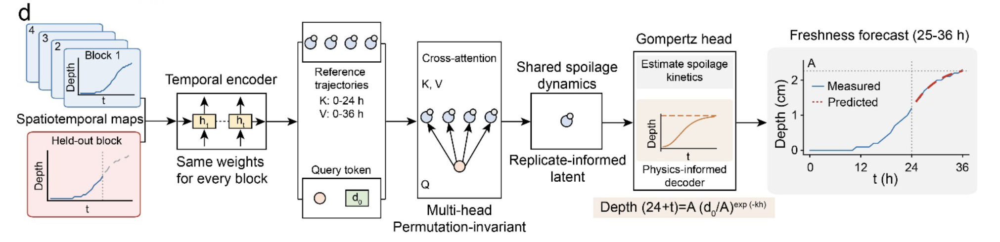

# AI-enabled spatiotemporal mapping and forecasting of internal food spoilage

Code for the AI analysis in the manuscript by Xuecheng Zhu, Peng Pei, Dinghan Wang,
Qing Wei, Baoguo Sun, Jiong-Wei Wang, Huilin Liu and Xiaogang Liu.

The implementation includes the replicate-assisted cross-attention neural-Gompertz
model (RCA-Gompertz), comparison methods, five-fold evaluation, and reconstruction
of the measured and predicted spoilage-depth fields.



## Prediction task

Each of six foods (beef, pork, chicken, duck, fish, and minced shrimp) was measured
at 4 °C and 25 °C. Each condition contains five replicate pieces, 37 hourly
observations from 0 to 36 h, and a 5 × 5 sensing grid. The measured response is
spoilage penetration depth in centimetres, bounded by the 3 cm sensing range.
The five `z` columns in the workbooks identify replicate pieces; their entries
are measured depths, not five spatial depth channels.

In each fold, one replicate index is excluded from training across all conditions.
The target piece supplies only hours 0-24. Four reference pieces supply complete
0-36 h trajectories. Forecasts cover hours 25-36.

This experiment assumes access to completed reference trajectories, including
hours 25-36. It evaluates prediction for a held-out replicate with reference
assistance. It does not evaluate a setting in which every piece is observed only
through hour 24, or generalization to new food categories or temperatures.

## System requirements

- **Operating systems:** tested on macOS 26.4.1 (Apple M3, arm64) and Ubuntu 24.04 LTS
  (x86-64, GitHub Actions). Other operating systems supported by Python 3.12 and
  PyTorch 2.10 are expected to work; Windows has not been tested.
- **Software:** Python 3.12 (tested with 3.12.9) and the pinned versions in
  `requirements.txt`: numpy 2.4.2, pandas 3.0.0, scipy 1.17.0, scikit-learn 1.8.0,
  torch 2.10.0, matplotlib 3.10.8, openpyxl 3.1.5 and threadpoolctl 3.6.0.
- **Hardware:** no non-standard hardware is required. A standard desktop or laptop CPU
  is sufficient (peak memory about 1.1 GB; about 0.9 GB of disk for the Python
  environment). A GPU is optional (`--device cuda` or `--device mps`); the release
  checkpoints in `models/` were trained on a CPU.

## Installation

Python 3.12 is the tested runtime. CPU execution is the default. Create an isolated
environment and install the recorded dependency versions:

```bash
python3.12 -m venv .venv
source .venv/bin/activate
python -m pip install -r requirements.txt
```

Installation takes about 1–5 min on a normal desktop computer, mostly to download
PyTorch (29 s on an Apple M3 laptop with a broadband connection).

## Demo

Run these commands from the repository root after installation. Times were measured
on an Apple M3 laptop using one CPU thread (the default).

| Command | Expected output | Run time |
| --- | --- | --- |
| `python -m unittest discover -s tests -v` | `Ran 8 tests ... OK` | ~5 s |
| `python scripts/prediction/run_experiment.py --neural-only --epochs 2 --folds 1 --output-dir results/smoke` | `results/smoke/` containing `predictions.csv`, the metric tables, `run_metadata.json` and `checkpoints/fold_1.pt`. The printed table shows MAE ≈ 0.14 cm (25 °C) and ≈ 0.22 cm (4 °C); this 2-epoch model is deliberately undertrained, and values can differ slightly across platforms. | ~5 s |
| `python scripts/prediction/predict.py --checkpoint-dir models` | 18,000 held-out forecasts in `results/checkpoint_predictions/`, with RCA-Gompertz MAE 0.0291 cm (25 °C) and 0.0502 cm (4 °C), matching `models/summary_by_method_temp.csv` | ~4 s |
| `python scripts/prediction/run_experiment.py` | Full reproduction in `results/reproduced/` (five folds × 600 epochs plus all comparison methods). RCA-Gompertz MAE ≈ 0.029 cm and R² ≈ 0.980 at 25 °C, and MAE ≈ 0.050 cm and R² ≈ 0.988 at 4 °C; comparison-method forecasts identical to `results/reference/` | ~13 min |
| `python scripts/prediction/compare_results.py` | JSON report of differences from the recorded paper forecasts: mean absolute difference ≈ 2 × 10⁻⁴ cm for RCA-Gompertz and 0 for the comparison methods | a few seconds |

## Reproduce the analysis

Generate all five neural models, the five comparison methods, predictions,
training histories, checkpoints and metric tables from the included workbooks:

```bash
python scripts/prediction/run_experiment.py
```

The default schedule is 600 full-batch epochs for each held-out replicate.
Results are written to `results/reproduced/`. The recorded paper results remain
in `results/reference/`.

Compare a completed run with the recorded per-cell outputs:

```bash
python scripts/prediction/compare_results.py
```

For an installation check, run a short training job on one fold:

```bash
python scripts/prediction/run_experiment.py --neural-only --epochs 2 --folds 1 --output-dir results/smoke
```

This short run checks the pipeline; it is not the training schedule used for
reported results. `--neural-only` and `--baselines-only` run the two parts separately.
`--device cuda` or `--device mps` selects an accelerator when supported by the
installed PyTorch build. Numerical differences across hardware and library
versions should be expected.

## Saved model inference

The validated release checkpoints are included in `models/`. Recreate their
held-out predictions without retraining:

```bash
python scripts/prediction/predict.py --checkpoint-dir models
```

To evaluate newly trained checkpoints:

```bash
python scripts/prediction/predict.py --checkpoint-dir results/reproduced/checkpoints
```

Both commands write fresh predictions and summaries to `results/checkpoint_predictions/`.
See [model documentation](models/README.md) for training provenance and the
distinction between the recorded paper outputs and the release verification run.

## Running the code on your own data

1. Create a folder with one workbook per food, named `<Food>.xlsx` and laid out as
   described in [data/README.md](data/README.md): one sheet per storage temperature
   (for example `4℃` and `25℃`), and one block per hour headed `<Food> <T>℃ (<h> h)`,
   followed by the columns `x`, `y` and five `z` replicate columns containing depths
   in cm.
2. Train and evaluate on these data:

   ```bash
   python scripts/prediction/run_experiment.py --data-dir path/to/workbooks --output-dir results/my_run
   ```

3. Or forecast with the released checkpoints:

   ```bash
   python scripts/prediction/predict.py --checkpoint-dir models --data-dir path/to/workbooks --output-dir results/my_forecasts
   ```

This release checks that the input follows the published design: Beef, Chicken, Duck,
Fish, Pork and Shrimp at 4 °C and 25 °C, hourly from 0 to 36 h, a 5 × 5 grid, five
replicates and depths of 0–3 cm. Other foods, temperatures or durations require
editing `MEATS` and `TEMPS` in `nn_replicate_attention.py` and `validate_contexts` in
`run_experiment.py`.

To forecast a new piece whose 25–36 h measurements do not exist yet, copy `data/raw/`
to a new folder. In the sheet for the piece's food and temperature, put the new piece
in one replicate column (for example `z (n1)`) with any placeholder depths (0–3 cm) for
hours 25–36, and keep complete 0–36 h reference trajectories in the other four columns.
After running `predict.py`, use the rows for that food and temperature whose `fold`
equals the column number. These forecasts do not depend on the placeholders (checked in
`tests/test_experiment.py`), but ignore their `true_depth` values and the metrics.

## Reproduce the AI figure panels

Render the paper's five-method comparison and the measured/predicted 3D blocks:

```bash
python scripts/prediction/render_paper_figures.py
python scripts/prediction/render_architecture.py
```

The scripts produce a vector architecture schematic and PDF/PNG versions of the numerical panels corresponding
to Fig. 2e, Fig. 2f and Supplementary Fig. 19, together with their plotting data.
The default is the recorded paper results and held-out replicate 1. Final
manuscript assembly, microscopy panels and the sensing-device illustrations are
outside this repository.

To plot freshly reproduced results or include the additional gradient-boosting
comparison:

```bash
python scripts/prediction/render_paper_figures.py --results-dir results/reproduced --output-dir figures/reproduced
python scripts/prediction/render_paper_figures.py --all-methods --output-dir figures/all_methods
```

The paper figure shows persistence, linear extrapolation, per-cell Gompertz,
replicate-informed Gompertz and RCA-Gompertz. The full result tables also retain
the gradient-boosting comparison. At 4 °C and in the pooled results, gradient
boosting has a lower MAE than RCA-Gompertz; the paper-panel selection should not
be interpreted as a comparison against every method in the repository.

## Model and evaluation

The neural model uses a shared 48-unit GRU, food/temperature/location embeddings,
four-head cross-attention and an anchored Gompertz decoder with a bounded residual.
It contains 32,739 trainable parameters. Each fold pools the six foods and two
temperatures into one model. Spatial cells are encoded individually; position
embeddings identify locations, without aggregating neighbouring measurements.

AdamW uses an initial learning rate of 0.003, weight decay of 0.0001, cosine
annealing and gradient clipping. The loss combines weighted absolute error with
0.3 times weighted squared error. Bounds and monotonicity are enforced on the
output. See [Methods](docs/methods.md) for the precise information flow, loss,
normalization, split and metric definitions. The [model card](MODEL_CARD.md)
summarizes intended use, training data, evaluation and limitations.

There are 1,200 cell-level training rows per fold and 18,000 held-out neural
predictions across five folds. Cells, horizons and folds do not constitute
18,000 independent biological samples.

Recorded RCA-Gompertz results:

| Subset | MAE (cm) | RMSE (cm) | R² | Predictions |
| --- | ---: | ---: | ---: | ---: |
| 25 °C | 0.029073 | 0.053096 | 0.979574 | 9,000 |
| 4 °C | 0.050214 | 0.066021 | 0.987713 | 9,000 |
| Both temperatures | 0.039643 | 0.059908 | 0.995410 | 18,000 |

These are pooled metrics recomputed from the recorded per-cell forecasts, not
averages of fold-level R² values.

## Files

| Location | Contents |
| --- | --- |
| `data/raw/` | Six input workbooks for the forecasting experiment |
| `data/README.md` | Workbook layout and measurement semantics |
| `scripts/prediction/spoilage_data.py` | Workbook parsing and tensor assembly |
| `scripts/prediction/nn_replicate_attention.py` | RCA-Gompertz architecture and episodic training |
| `scripts/prediction/baselines.py` | Comparison methods and metric aggregation |
| `scripts/prediction/run_experiment.py` | Full experiment and training metadata |
| `scripts/prediction/predict.py` | Inference from saved fold checkpoints |
| `scripts/prediction/render_paper_figures.py` | Numerical AI figure panels |
| `scripts/prediction/render_spoilage_3d.py` | Shared two-colour block renderer |
| `results/reference/` | Recorded paper predictions and summaries |
| `models/` | Checkpoints from the documented release verification run |
| `MODEL_CARD.md` | Model card: intended use, training data, evaluation and limitations |
| `tests/` | Data, split-isolation and model constraint checks |

## Checks

```bash
python -m unittest discover -s tests -v
```

Checks cover raw-data dimensions and recorded target values, exclusion of all
held-out data from training, invariance of predictions to the held-out future,
reference-set permutation, masked padding, output bounds, monotonicity and
recomputation of the recorded metrics.

## Code availability

The code and source data used for the AI forecasting analysis and associated
plots in this manuscript are available at
https://github.com/foodspoilageforecast/food-spoilage-forecasting.

The release covers the AI analysis. It does not contain the other experimental
measurements or unpublished manuscript files. Software is distributed under the
[MIT license](LICENSE). The included measurement data are provided to reproduce
the accompanying analysis; cite the associated article when using them.

## Contact information
If you have any questions, please feel free to contact us (chmlx@nus.edu.sg).
